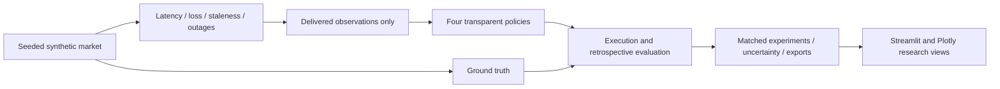

# MarketLens — Trading Under Uncertainty

**Making better trading execution decisions when market information is delayed,
incomplete, or unreliable.**

MarketLens is a synthetic quantitative research and decision-support platform.
It asks **how should execution adapt when market data is delayed, missing, or
stale?** The aim is rigorous comparison and explainable trade-offs, not price
prediction or a profitable trading bot. It is designed for a hypothetical trading
operations analyst, with researchers, engineers and risk/product teams as secondary
users. There is no affiliation with any trading firm.

## Implemented features

- Seeded geometric Brownian motion with explicit annualised units, bid/ask quotes,
  liquidity, and stable/high-volatility/low-liquidity parameter presets.
- Fixed latency, independent missing updates, stale windows, delivery outages and
  combined faults. Immutable truth and delivered observations stay separate.
- Four interpretable policies: Always Execute, Wait for Fresh Data, Data Quality
  Guardrail and Adaptive Decision Policy. Policies receive only current observations.
- Single-asset marketable buys, contemporaneous execution, all-or-none liquidity
  checks, spread/impact/fee decomposition and a common arrival-price benchmark.
- Matched multi-seed experiments; completion and non-execution rates; filled-order
  shortfall, delay and tail statistics; confidence intervals; paired differences;
  explicit non-execution counterfactuals and penalty sensitivity.
- Seven interactive Streamlit views, Plotly charts, decision traces, stress sweeps,
  volatility/latency heatmap, CSV downloads and replayable JSON configuration.
- Automated domain and UI tests, Ruff checks and documented actual experiment outputs.

## Why this project

A quote can look precise while already being out of date. Executing, waiting and
pausing each have costs. MarketLens makes those assumptions visible, including the
risk that a policy looks cheap simply because it rarely completes an order.
Research questions include latency sensitivity, when fresher information justifies
waiting, when pausing creates missed opportunities, and how volatility, liquidity,
order size and reliability interact. Any apparent policy advantage must be tested
across seeds, thresholds and assumptions.

## Architecture



Core calculations live in `src/marketlens`, independent of Streamlit. Integer
milliseconds distinguish event time from delivery time. A policy never receives
the ground-truth path, future quotes or the fault schedule. Ground-truth charts
are explicitly retrospective. See [architecture](docs/architecture.md) and
[methodology](docs/methodology.md) for models, rules and boundary semantics.

## Installation (macOS or Linux)

Use Python **3.11+**. From a checkout of this repository:

```sh
cd Trading-Project
python3 --version
python3 -m venv .venv
source .venv/bin/activate
python -m pip install -e '.[dev]'
```

On macOS, if Python 3.11+ is not installed, install it from python.org or use your
preferred package manager (for example, `brew install python@3.12`, then use
`python3.12` above). These are standard setup instructions; verification here used
Linux and Python 3.12.14, not macOS.

Runtime dependencies: NumPy, Pandas, SciPy, Streamlit and Plotly. Development tools:
pytest, pytest-cov and Ruff. `requirements-lock.txt` records exact versions used in
the verification environment. To reproduce that Linux/Python 3.12 setup:

```sh
python -m pip install -r requirements-lock.txt
python -m pip install --no-deps -e .
```

Other Python/platform combinations should resolve compatible versions from
`pyproject.toml`; cross-version bit-identical random output is not promised.
No API keys, market-data subscription or database is required.

## Run the application

From the checkout root with the virtual environment active:

```sh
streamlit run app/main.py
```

Use the sidebar to configure markets, faults, orders and thresholds. The seven
views are Executive Overview, Market Simulation, Policy Comparison, Scenario
Stress Testing, Decision Explorer, Product Insights, and Methodology & Limitations.
Select policies, then press **Run matched experiment**. Preview uses 10 seeds;
full runs default to 100. Changes to configuration invalidate old comparison
results. Product Insights identifies the last executed experiment explicitly.

The app has a navy/teal theme. All charts use real engine outputs. No fictional
screenshots are included. Startup and automated interactions were tested; browser
visual inspection and usability research have not been performed.

## Run tests and quality checks

```sh
python -m pytest --cov=marketlens --cov-report=term-missing
ruff check src tests app
ruff format --check src tests app
```

Tests cover seeds and GBM units, quote invariants, fault boundaries and composition,
observation causality, policy timeouts, look-ahead resistance, liquidity failures,
execution cost identities, matched seeds, metrics, export replay and UI interactions.
Actual verification outcomes and commands are in [verification](docs/verification.md).

## Reproduce experiments

```sh
marketlens-experiment --suite latency --trials 100 --seed 42 --output results/latency
marketlens-experiment --suite combined --trials 100 --seed 42 --output results/combined
marketlens-experiment --manifest results/latency/manifest.json --output results/replay
```

Available suites: `latency`, `missing`, `volatility`, `liquidity`, `combined`,
`thresholds`, `heatmap`. Exports include all trial outcomes, summaries, paired
comparisons, penalty sensitivity and full configuration/software metadata.
See [experiment instructions](docs/experiments.md). Existing output files in the
chosen destination are overwritten.

### Findings from executed examples

The checked-in [latency run](results/latency/summary.csv) used 100 seeds (42–141),
six latency levels and four policies: 2,400 trial-policy outcomes. With a 100 ms
freshness threshold, all four policies completed at 0, 50 and 100 ms latency.
At 250, 500 and 1,000 ms, the unconditional baseline completed; the three
quality-sensitive policies did not. Fixed latency makes a ≤100 ms old quote
unattainable in those settings, so this outcome follows the configured rules.

In the [combined run](results/combined/summary.csv), 100 seeds across two scenarios
produced 800 outcomes. The baseline's mean total shortfall was $1.20 in the base
scenario and $4.10 in the low-liquidity combined-failure scenario. The latter
has 3x spread and 0.1x liquidity; its three quality-sensitive policies did not
complete. These are synthetic, assumption-dependent outcomes, not proof of an
optimal policy. Filled costs for non-executing policies are undefined, not zero.
These examples primarily validate mechanics; they do not demonstrate a guardrail
outperforming unconditional execution. Saved sensitivity files show how conclusions
about adjusted costs depend on non-execution penalties.

## Product strategy

The [Product Strategy Case Study](docs/product_strategy.md) defines the hypothetical
users, journey, impact-versus-effort prioritisation, quality metrics and strategic
trade-offs. The product emphasizes decision traceability and completion-aware
comparisons. Personas and prioritisation are design assumptions; no interviews,
adoption figures or commercial outcomes are invented.

## Limitations and next steps

GBM is uncalibrated and omits jumps, microstructure and volatility clustering.
Spreads/liquidity are constant. Fixed latency and independent loss omit realistic
network correlation. Execution has no partial fills, queue or replenishment.
Student-t intervals and empirical tails need sufficient independent trials;
multiple comparisons are unadjusted. Non-execution penalties are assumptions.
See [limitations](docs/limitations.md).

Future work: correlated faults and latency jitter, alternative market dynamics,
partial fills, calibration with licensed data, stronger packaging/static typing,
user-tested dashboard design and independent model/risk validation. Real trading,
portfolio management and broker integration are outside this prototype.

[Implementation roadmap](docs/implementation_plan.md) ·
[Architecture](docs/architecture.md) · [Methodology](docs/methodology.md) ·
[Experiments](docs/experiments.md) · [Product strategy](docs/product_strategy.md)
