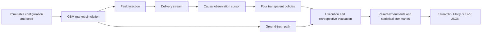

# Architecture

Core modules have no Streamlit dependency. Frozen dataclasses define configuration
and event contracts. `MarketEvent` is truth; `ObservedQuote` contains only a delivered
quote and its original event time. `Observation` is the policy's entire market
interface: current clock, last delivered quote, received count and last inferred
sequence gap. It contains neither the path nor the future delivery schedule.
The orchestrator owns the truth and schedule; policies do not receive either.
Python is not a hostile-code sandbox: this is an API/data-flow boundary.

## Clock and event model

All timestamps are relative integer milliseconds, no timezone or wall-clock input.
Market events include t=0 and the horizon, requiring duration divisible by step.
IDs start at zero, increasing once per source update. A quote has a mid, bid, ask,
absolute spread in currency/share, bid/ask liquidity in shares and regime label.
GBM uses dt = step_ms / (365.25 * 24 * 3600 * 1000), drift/volatility per year.
Regimes are fixed parameter presets: stable (1x), high volatility (3x volatility,
2x spread), low liquidity (0.1x liquidity, 3x spread), not switching regimes.
Invalid or numerically unrepresentable paths raise errors; prices are not clipped.

Loss draws once per source event using its own NumPy generator. A stale interval
suppresses source updates. Latency shifts delivery. Outages suppress deliveries
whose shifted timestamp falls inside the interval. Intervals are [start,end).
Suppression never changes truth, never refreshes the held quote's timestamp, and
never creates a recovery backlog. Overlapping intervals form an effective union.
Deliveries beyond the source horizon are retained, but evaluation stops at the
source horizon. Delayed quotes at exactly a decision time are visible.

The observation holds the last successful quote through silence, including an
outage; without any prior delivery it is unavailable. Missing update counts are
inferred from sequence gaps only after a later delivery. A policy cannot observe
in-flight loss or future outage windows.

## Decisions and execution

Evaluation includes regular decision ticks, delivery timestamps, arrival,
max-wait/pause boundaries, deadline and horizon. At each time deliveries are
processed before a decision. The market is piecewise constant between source
events; execution uses the latest truth event at or before execution time. No
interpolation from future prices. Deadline is inclusive. No execution occurs after
the horizon. First execute or pause is terminal; wait may continue. A failed
all-or-none liquidity check is a terminal rejection, not an automatic retry.

See methodology for policy thresholds, accounting, and non-execution assumptions.

## Model contracts

| Model | Fields / role |
| --- | --- |
| `MarketConfig` | Initial price, duration/step, drift, sigma, absolute spread, size, seed, regime |
| `MarketEvent` | Source ID/time, mid/bid/ask/spread, bid/ask liquidity, regime; immutable truth |
| `ObservedQuote` | Same quoted values plus original event time and actual delivery time |
| `Delivery` | Immutable observed-quote envelope; suppressed events have no delivery |
| `FaultConfig` | Latency, missing probability, source-stale and delivery-outage intervals, seed |
| `Observation` | Decision time, held quote or None, received count, last observable sequence gap |
| `PolicyConfig` | Freshness, max wait, silence, spread/gap thresholds and timeout fallback |
| `OrderConfig` | Arrival/deadline, quantity, fee/share, impact coefficient, optional benchmark |
| `Decision` | Execute/wait/pause and human-readable reason |
| `Fill` | Actual time, quantity, truth mid, execution price and cost decomposition |
| `Evaluation` | Policy, benchmark, optional fill, terminal reason/time, opportunity cost, trace |
| `Scenario` | Complete immutable market/fault/order/policy configuration and decision resolution |
| `ExperimentResult` | Per-trial records, summaries, paired comparisons, sensitivity and manifest |

Runtime and exports never reinterpret an absent fill as a zero execution price.
Float64 pricing is used for synthetic analysis; this is not decimal venue tick
accounting. No tick/lot rounding or exchange calendar is claimed.

## Product intelligence boundary (0.2)

`intelligence.py` derives retrospective diagnoses and human-readable comparisons
from executed outcomes. It never supplies information to `Policy.decide`.
`visualization.py` builds Plotly truth/observed traces and action markers from
immutable events and traces; decision markers use observed values. The dashboard
owns presets, presentation and current/outdated result labels. Scenario presets
and new suites are in `experiments.py`; the healthy API default remains unchanged.
Schema-2 metrics add integrated pending exposure and observable quote-age at fill.
`joint_fills.csv` reports realized paired differences only when both orders fill;
penalty-adjusted paired comparisons remain a separate export. No predictive or
recommendation engine was added.
